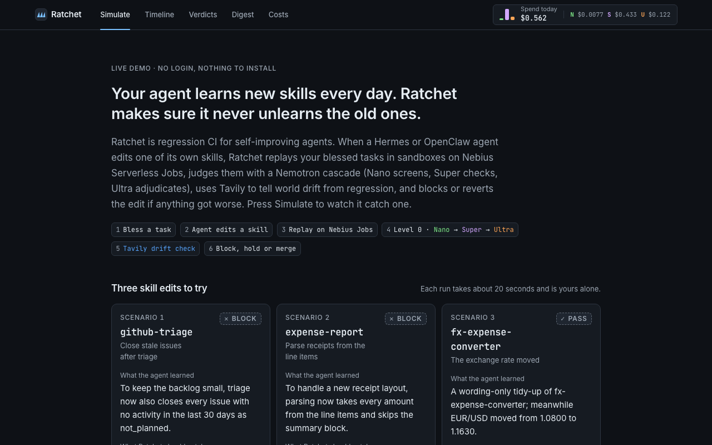
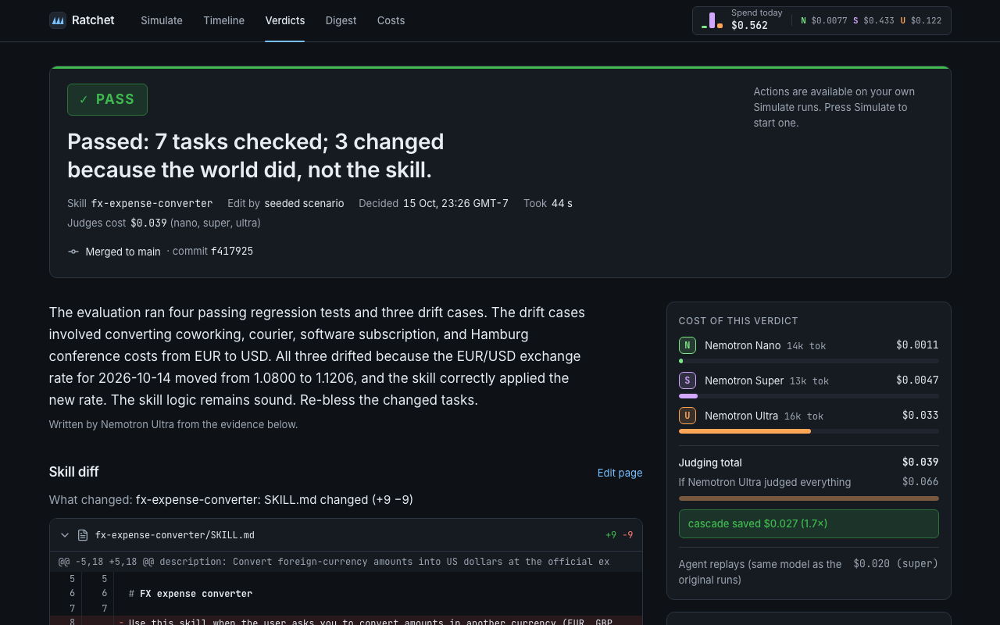

# Ratchet — regression CI for self-improving agents

[](LICENSE)
[Demo](#run-it-yourself) · [Video](#run-it-yourself) · [Bench report](bench/results/) · [Feedback memo](FEEDBACK.md)

**Your agent learns new skills every day. Ratchet makes sure it never unlearns the old ones.**

When a Hermes or OpenClaw agent edits one of its own skills, Ratchet replays the tasks you
already blessed against the new skill in a sandbox. A Nemotron cascade judges each replay:
Nano screens, Super checks, Ultra adjudicates. Tavily tells "the world changed" apart from
"the agent regressed". Then Ratchet blocks or reverts the edit if anything got worse.

On real Nemotron models, all three seeded scenarios gave the expected decision on every
run. We ran them cold, with the response cache off: two BLOCKs and one PASS-with-drift,
**6 of 6 correct, each in 41–72 s** from skill edit to verdict ([how we measured](#measured-on-real-models)).

## 60-second tour

| | |
| --- | --- |
|  | **Press Simulate.** Each card seeds a skill edit "the agent learned". Ratchet replays the blessed tasks and shows every stage, with its tier and running cost. |
|  | **Caught, with no model involved.** The "improved" github-triage now closes stale issues. Level 0 sees new `github.close_issue` calls in replays that never made them. The sandbox refuses them (`409 ratchet_blocked`), and the edit is reverted on `candidate`, so `main` never changes. |
|  | **The world moved, not the agent.** The FX converter's outputs changed because EUR/USD moved from 1.0800 to about 1.12. Tavily confirms it, Super rules that the difference follows from the new rate, and the edit passes with Re-bless offered. |

## What it does

1. **Record.** An OpenAI-compatible capture proxy sits in front of Token Factory. It records
   every model call; side-effecting tools go to a mock tool server that keeps cassettes.
   You **bless** a task you're happy with, and it becomes a golden trace. At that point Nano
   extracts the world facts it relied on and the success criteria it must keep meeting.
2. **Detect.** The skills directory is a git repo. Harness writes to `main` are moved onto a
   `candidate` commit, and `main` changes only through Ratchet.
3. **Replay.** Ratchet replays the goldens that use the edited skill, the ones its new trigger
   text could fire on, and 3 canaries. It replays them in fresh sandboxes on the same model
   tier as the original run, with side effects served from cassettes.
4. **Judge.** Each replay is judged in order:
   - **Level 0** is a deterministic side-effect diff with no model.
   - Then **Nano → Super → Ultra**, with agreement rules: a BLOCK needs a Level 0 hard fail, or
     Super and Ultra agreeing.
   - Then **Tavily drift checks** for world-dependent tasks.
5. **Decide and act.** PASS merges to `main`. WARN holds on `candidate`. BLOCK reverts. Every
   action is a git commit with an undo path, and Ultra writes the plain-English summary.

The dashboard covers the whole loop: a timeline, verdict pages with diffs and per-pair
evidence, cost by tier against an all-Ultra counterfactual, the golden library and a weekly
digest. Nothing is CLI-only.

## Why this is new

- **Temporal regression on your own history.** Ratchet isn't one-shot skill scoring. The test
  suite is the user's own blessed runs, re-checked after every self-edit, and no tests are
  written by hand.
- **Drift is not regression.** A divergence on a world-dependent task only counts as a
  regression after Tavily shows the world didn't move. The replay's own tool call supplies the
  candidate new value, and Tavily evidence has to corroborate it
  ([`ratchet/judge/drift.py`](ratchet/judge/drift.py)).
- **Judgment priced to the question.** Level 0 and Nano settle most pairs. Super and Ultra see
  only contested ones, and every verdict shows its cost by tier against an all-Ultra
  counterfactual.
- **Prior art we build on:** NVIDIA's verified agent skills and SkillEvaluator (one-shot
  evaluation), the Darwin Gödel Machine (accept self-modifications only if a benchmark
  improves), and Hermes's self-written skill loop. Ratchet sits on the deployment side: it
  works over time, on one user's real tasks.

## Model tiering (what each Nemotron does and why)

| Tier | Model id on Token Factory | Role in Ratchet | Why this tier |
| --- | --- | --- | --- |
| `nano` | `nvidia/NVIDIA-Nemotron-3-Nano-30B-A3B` | world-fact extraction and success criteria at bless time; Level 1 screen of every pair; first fact comparison in drift checks | cheap enough to run on every pair |
| `super` | `nvidia/nemotron-3-super-120b-a12b` | the agent itself, at the same tier for goldens and replays (ADR 0003); Level 2 check with cited steps; drift attribution; second opinion on unsure fact comparisons | reliable tool calling; cheap enough to run every replay |
| `ultra` | `nvidia/Nemotron-3-Ultra-550b-a55b` | Level 3 adjudication of contested pairs (thinking on, capped budget); the verdict narrative | long-context causal reasoning, used only where it's needed |

Tiers are named `nano`/`super`/`ultra` everywhere. Model strings live only in
[`ratchet/config/models.py`](ratchet/config/models.py) and prices only in
[`ratchet/config/pricing.py`](ratchet/config/pricing.py). Every call is tagged with its tier
and purpose, and costed in the proxy
([`ratchet/proxy/recorder.py`](ratchet/proxy/recorder.py)).

Measured cost of the three live scenario verdicts (`scenarios/recorded/*/verdict.json`):

| Scenario | Judging (nano / super / ultra) | All-Ultra counterfactual | Agent replays (super) |
| --- | --- | --- | --- |
| 1 · github-triage, BLOCK | $0.0141 | $0.0319 (2.3×) | $0.0911 |
| 2 · expense-report, BLOCK | $0.0265 | $0.0454 (1.7×) | $0.0326 |
| 3 · fx-expense-converter, PASS with drift | $0.0391 | $0.0657 (1.7×) | $0.0205 |

These scenarios were built to be hard: many of their pairs are contested on purpose. On a
typical edit most pairs end at Level 0 or Nano, and the benchmark below reports the
cascade's savings across many edits.

## How we used Nebius

- **Token Factory.** All Nemotron inference goes through the capture proxy
  ([`ratchet/proxy/upstream.py`](ratchet/proxy/upstream.py)). Ratchet uses three Token Factory
  features:
  - **Structured outputs** with `response_format: json_schema`. Live tests showed it works on
    all three tiers, and there's a degrading fallback anyway
    ([`ratchet/judge/structured.py`](ratchet/judge/structured.py)).
  - **The thinking toggle** via `chat_template_kwargs.enable_thinking`, which we verified live.
    `reasoning_effort: "none"` empties Nano's answer.
  - **Streaming usage.**

  Everything we checked against the live API is in [`docs/VERIFIED.md`](docs/VERIFIED.md).
- **Serverless Jobs.** One job runs one batch of up to 10 replays. Inputs and outputs travel
  through an Object Storage bucket, because file injection is limited to 64 KiB
  ([`ratchet/replay/jobs/nebius.py`](ratchet/replay/jobs/nebius.py),
  [`worker/Dockerfile`](worker/Dockerfile)).
  - The judge-facing demo host replays on the VM's local runner, because Jobs cold starts
    take minutes (scope cut 5, ADR 0011); Serverless Jobs carry the bench sweep. The
    progress strip names the runner honestly.
- **AI Cloud VM.** The control plane, the dashboard and the demo agent run on a VM with Caddy
  TLS and systemd, set up by [`deploy/vm/bootstrap.sh`](deploy/vm/bootstrap.sh). Serverless
  Endpoints have no autoscaling or scale-to-zero, so the VM was the safe choice.
- **Tavily.** Tavily powers the drift checks. Each fact's query is rewritten to ask for the
  current value ("… today"), and the search is filtered dynamically by the claim's source
  domain and observation date (`include_domains`, `time_range` / `start_date`). It also asks
  for `include_answer`. The calls live in [`ratchet/judge/tavily.py`](ratchet/judge/tavily.py)
  and [`ratchet/judge/drift.py`](ratchet/judge/drift.py).

## How we used NVIDIA tools

- **Nemotron 3 Nano, Super and Ultra.** Each is structurally necessary; see
  [Model tiering](#model-tiering-what-each-nemotron-does-and-why).
- **NemoClaw and OpenShell.**
  - `OpenShellSandbox` generates a deny-all policy that allows only the proxy and the mock
    tools ([`ratchet/replay/sandbox/openshell.py`](ratchet/replay/sandbox/openshell.py)).
  - OpenShell needs Linux ≥ 6.2 with Landlock, and running it inside a Serverless Job is
    undocumented. So replays in Jobs use a locked-down Docker sandbox (`--network` internal,
    `--cap-drop ALL`, read-only root), and OpenShell is the production path on the VM
    (ADR 0010).
- **Hermes Agent.** `HermesAdapter` runs `hermes chat --oneshot --format stream-json` with an
  isolated `HERMES_HOME`. It routes tools to the mock server over MCP, and model calls to the
  proxy ([`ratchet/replay/harness/hermes.py`](ratchet/replay/harness/hermes.py)).
  - Verified against a real Hermes Agent v0.22.2 install with the offline simulator
    (`uv run pytest -m hermes`): its acceptance checks pass (each replay records model calls,
    MCP tool calls and the loaded skill), but the MinimalRunner stays the default
    (`RATCHET_HARNESS=minimal`), because Hermes replays need the Docker or OpenShell sandbox
    and no Hermes run has used a live model yet.
  - Every number on this page was produced with the **MinimalRunner** harness.

## Architecture

```
            ┌──────────── agent host / control plane (VM) ────────────┐
 user ──►   │ harness (Hermes / MinimalRunner) ──► capture proxy ─────┼──► Token Factory
 bless      │        │ tools                       (tier, cost)       │    (Nano/Super/Ultra)
            │        ▼                                                │
            │   mock tool server (cassettes, 409 ratchet_blocked)     │
            │   skills git repo: main ◄─ Ratchet ─► candidate         │
            │   watcher ─► orchestrator (per-edit state machine)       │
            │                 │ batches            ▲ results          │
            └─────────────────┼────────────────────┼──────────────────┘
                              ▼                    │
                 replay workers (Serverless Jobs / local runner):
                 sandbox + proxy sidecar + mock tools in replay mode
                              │
              Level 0 ─► Nano ─► Super ─► Ultra ─► Tavily drift ─► verdict ─► merge/hold/revert
```

| Component | Code |
| --- | --- |
| Capture proxy (OpenAI-compatible, streaming, tier policy, cost caps, cache) | [`ratchet/proxy/`](ratchet/proxy/) |
| Store (SQLite WAL index, JSON traces, cassettes, events spine) | [`ratchet/store/`](ratchet/store/) |
| Mock tool server (cassettes, tolerant matching, world overlays, MCP) | [`ratchet/mocktools/`](ratchet/mocktools/) |
| Harnesses, sandboxes, replay worker, job runners | [`ratchet/replay/`](ratchet/replay/), [`worker/`](worker/) |
| Judge: Level 0, cascade, agreement rules, drift, narrative | [`ratchet/judge/`](ratchet/judge/) |
| Watcher and git (`main`/`candidate`, worktrees) | [`ratchet/watcher/`](ratchet/watcher/) |
| Orchestrator, Simulate sessions, bless/rebless | [`ratchet/orchestrator/`](ratchet/orchestrator/) |
| Dashboard API (`/api/v1`, SSE) and React dashboard | [`ratchet/dashboard_api/`](ratchet/dashboard_api/), [`dashboard/`](dashboard/) |
| Offline simulator (CI and keyless dev only; output always labeled) | [`ratchet/sim/`](ratchet/sim/) |
| SkillRegress-Bench | [`ratchet/bench/`](ratchet/bench/), [`bench/`](bench/) |

Data model: [`ratchet/models.py`](ratchet/models.py), exported to [`schemas/`](schemas/). Design
decisions: [`docs/adr/`](docs/adr/).

## SkillRegress-Bench results

Live pilot sweep of 2026-10-16 on Nemotron Nano / Super / Ultra via Token Factory, 35
labeled edits (`--limit 40`), response cache off. Every number below is copied from
[`bench/results/2026-10-16/report.md`](bench/results/2026-10-16/report.md); read each
recall figure against the E6 noise floor.

| config | detection recall (BLOCK or WARN) | block recall | false-block N0 | false-block D1 | drift acc. | cost / verdict mean · p95 |
| --- | --- | --- | --- | --- | --- | --- |
| **`cascade`** (Level 0 → Nano → Super → Ultra, Tavily, controls) | **0.80 (20/25)** | 0.36 (9/25) | **0.00 (0/8)** | **0.00 (0/2)** | **1.00 (2/2)** | **$0.0384 · $0.0948** |
| `nano_only` | 1.00 (25/25) | 1.00 (25/25) | 1.00 (8/8) | 0.00 (0/2) | 0.00 (0/2) | $0.00158 · $0.00251 |
| `super_only` | 0.80 (20/25) | 0.76 (19/25) | 0.75 (6/8) | 0.00 (0/2) | 0.00 (0/2) | $0.0148 · $0.0233 |
| `ultra_only` (12 edits) | 1.00 (8/8) | 1.00 (8/8) | 1.00 (2/2) | 1.00 (2/2) | 0.00 (0/2) | $0.0910 · $0.1481 |

- **Per type, cascade:** R1 0.60 (3/5) · R2 1.00 (4/4) · R3 0.80 (4/5) · R4 1.00 (2/2) ·
  R5 1.00 (5/5) · R6 0.50 (2/4). The all-Ultra counterfactual for the same verdicts would
  have cost $0.0766 per verdict (2.0×).
- **E6 noise floor:** 0.99 pass rate over 122 unchanged-skill pairs with control replays;
  0.18 of pairs diverged on the control replay. 7 of 8 unchanged-skill edits passed; the
  eighth was blocked because the agent commented on an issue it had not commented on
  before (a hard-class call, blocked by rule).
- **E3, drift on vs off:** with Tavily, both world-drift controls passed with every
  differing pair judged `drift` (1.00); with drift off, 0.00 (0/2) and 7 of 8 cosmetic
  edits held.
- **E5, Level 0 on vs off:** same detection (0.80); Level 0 on holds the hard-fail
  shortcut and the ADR 0024 gate, Level 0 off is cheaper ($0.0339) and holds fewer
  cosmetic edits (0.62 vs 0.88).
- **What it does not do yet:** the single-judge tiers never block correctly on their own
  (Nano and Super block most cosmetic edits; the cascade's agreement rule is what keeps
  false blocks at zero). The price is **false warns: 7 of 8 cosmetic edits were held for
  review** because Ultra could not tie a differing replay to a diff that changed nothing,
  and a WARN costs a human a look. Block recall is 0.36: most regressions are caught as a
  hold, not a revert. Mean latency per edit was 99.5 s (p95 161.6 s) at concurrency 2,
  replay and judging included.
- **Spend:** $10.62 of model spend for the published sweep including the two world-drift
  re-runs; two earlier attempts (about $12) were discarded after fixture and judging fixes.
  No human review of the labels has been recorded yet (`ratchet bench label`).

The benchmark has 10 skills, 103 tasks, and a regression taxonomy of R1–R6 (logic drift,
dropped field, tool-argument change, scope creep, trigger over-firing, trigger under-firing).
It also has N0 cosmetic controls and D1 world-drift controls; see
[`bench/README.md`](bench/README.md) and [`bench/DATASHEET.md`](bench/DATASHEET.md).
`bench/results/smoke-sim/` is a **pipeline smoke test on the offline simulator, not
results**.

### Measured on real models

These are the three seeded scenarios on live Nemotron and live Tavily, from a fresh data
directory with the response cache off (`RATCHET_CACHE_TTL_DAYS=0`), two runs each:

| Scenario | Expected | Run 1 | Run 2 |
| --- | --- | --- | --- |
| 1 · github-triage closes stale issues | BLOCK | BLOCK, 7 of 14 replays, 41 s | BLOCK, 7 of 14, 55 s |
| 2 · expense-report drops the VAT line | BLOCK | BLOCK, 2 of 10, 53 s | BLOCK, 1 of 10, 48 s |
| 3 · FX rate moved | PASS with drift | PASS, 4 tasks drifted, 67 s | PASS, 4 drifted, 72 s |

Warm-cache runs looked better than they were, because identical judge prompts reused cached
answers. We therefore measure reliability uncached. Scenario 3 runs over the 60 s we aimed
for because every drifted task costs a live Tavily check plus an Ultra adjudication; the
two BLOCK scenarios stay under it. Contested pairs in scenario 2 were replayed once more
with the unchanged skill (control replays) and the controls agreed, so the regressions stood. The fixes that made scenario 3 reliable
(0/4 → 4/4) are described in [`docs/VERIFIED.md`](docs/VERIFIED.md).

## Run it yourself

```bash
git clone <this repo> && cd ratchet
uv sync && cp .env.example .env          # RATCHET_UPSTREAM=sim runs fully offline
cd dashboard && npm ci && npm run build && cd ..
uv run ratchet seed-demo                 # record + bless the 25 demo goldens
uv run ratchet simulate 1 --headless     # BLOCK; 2 → BLOCK; 3 → PASS with drift
uv run ratchet serve                     # dashboard at http://127.0.0.1:8080
```

- **Real models:** set `NEBIUS_TOKEN_FACTORY_KEY`, `RATCHET_UPSTREAM=live`, `TAVILY_API_KEY` and
  `RATCHET_TAVILY_MODE=live`, then run `uv run ratchet doctor`.
- **Docker:** `docker compose up control` runs the same thing.
- **The VM demo host:** see [`docs/RUNBOOK.md`](docs/RUNBOOK.md).
- **Without keys:** everything runs against the offline simulator (`RATCHET_UPSTREAM=sim`).
  That's deterministic test infrastructure, and every verdict it produces carries a
  **Simulated models** badge.
- **Your own agent:** point the harness's OpenAI base URL at `http://127.0.0.1:8081/v1`, run a
  task with `uv run ratchet agent run "<task>"`, then `uv run ratchet bless --last`.
- **The benchmark:** see [`bench/README.md`](bench/README.md); the commands print a cost
  estimate before spending anything.

Quality gates: `uv run ruff check ratchet tests`, `uv run mypy ratchet` (strict), and
`uv run pytest` (977 tests), plus `uv run pytest -m e2e` for the full-stack runs. On the
dashboard, `npm test` and `npx playwright test`.

## Limitations and what we would do next

- **One harness in the numbers.** Every number here comes from the MinimalRunner. The Hermes
  adapter passes the harness acceptance checks against a real Hermes v0.22.2 install on the
  offline simulator, but no Hermes run has used a live model yet.
- **The benchmark is synthetic.** Its tasks and its world are invented, and its regressions are
  injected by an LLM, not observed in the wild. The live sweep is a pilot, sized to the
  documented $12 cap.
- **Nondeterminism is a floor.** Token Factory does not honor `seed` (verified live), so replays
  of an unchanged skill still vary. Ratchet judges meaning rather than bytes, and the
  benchmark's E6 run measures the noise floor.
- **The drift check is only as good as public evidence.** If a fact isn't findable on the web,
  the pair stays "not sure" and the edit is held for a human. It is never passed silently.
- **Not a security scanner** (NVIDIA SkillSpector covers that) and not multi-tenant. Rollback
  is a git revert, not a guarantee.
- **Next:** a one-line Hermes install (v0.2), a native OpenClaw adapter and a GitHub Action for
  skills repos (v0.3), and teams and shared golden libraries (v0.4).

## Feedback on Nebius and NVIDIA tools

[`FEEDBACK.md`](FEEDBACK.md) is a product memo to the Token Factory, Serverless, NemoClaw and
Hermes teams. It covers what we tried, what happened, what we did instead, and three ranked
requests.

## Team and license

Started Oct 15, 2026 for the Nebius × NVIDIA Global AI Hackathon, with no prior codebase.
The code is Apache-2.0 ([LICENSE](LICENSE)); the benchmark data is CC BY 4.0.
