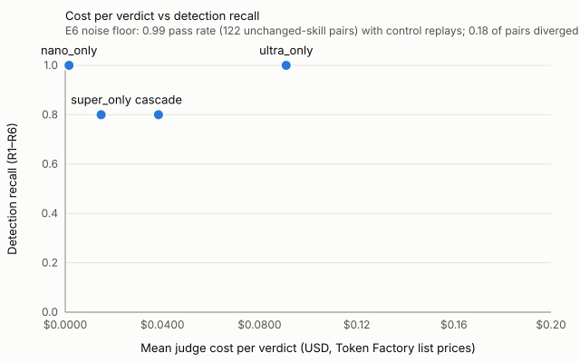

# SkillRegress-Bench results — 2026-10-16

| | |
| --- | --- |
| Harness | `minimal` (agent tier `super`) |
| Models | nano: `nvidia/NVIDIA-Nemotron-3-Nano-30B-A3B`, super: `nvidia/nemotron-3-super-120b-a12b`, ultra: `nvidia/Nemotron-3-Ultra-550b-a55b` |
| Date | 2026-10-16 (results updated 2026-10-16 13:59 UTC) |
| Git sha | `e288982` |
| Labels | `bench/labels/labels.json` — 35 edits (D1 2, N0 8, R1 5, R2 4, R3 5, R4 2, R5 5, R6 4) |
| Human review | 0 of 17 required reviews recorded |
| E6 noise floor | 0.99 pass rate (122 unchanged-skill pairs) with control replays; 0.18 of pairs diverged on the control replay |

Produced by:

- `noise` (E6): `ratchet bench run --config bench/configs/noise.yaml --out bench/results/2026-10-16 --limit 8 --yes`
- `cascade` (E1, E2, E3, E4, E5): `ratchet bench run --config bench/configs/cascade.yaml --out bench/results/2026-10-16 --types D1 --limit 2 --yes`
- `nano_only` (E4): `ratchet bench run --config bench/configs/nano_only.yaml --out bench/results/2026-10-16 --types D1 --limit 2 --yes`
- `super_only` (E4): `ratchet bench run --config bench/configs/super_only.yaml --out bench/results/2026-10-16 --types D1 --limit 2 --yes`
- `ultra_only` (E4): `ratchet bench run --config bench/configs/ultra_only.yaml --out bench/results/2026-10-16 --types D1 --limit 2 --yes`
- `drift_off` (E3): `ratchet bench run --config bench/configs/drift_off.yaml --out bench/results/2026-10-16 --types D1 --limit 2 --yes`
- `level0_off` (E5): `ratchet bench run --config bench/configs/level0_off.yaml --out bench/results/2026-10-16 --types D1 --limit 2 --yes`

## Table 2 — detection, false blocks and cost per configuration (E1, E2, E4)

Computed by `summarize` in [`metrics.py`](../../../ratchet/bench/metrics.py). Recall counts BLOCK or WARN; read every recall figure against the E6 noise floor in the last column.

| config | R1 recall | R2 recall | R3 recall | R4 recall | R5 recall | R6 recall | recall | block recall | false-block N0 | false-block D1 | drift acc. | cost/verdict mean / p95 | all-Ultra mean | E6 noise floor |
| --- | --- | --- | --- | --- | --- | --- | --- | --- | --- | --- | --- | --- | --- | --- |
| `nano_only` | [1.00 (5/5)](../../configs/nano_only.yaml) | [1.00 (4/4)](../../configs/nano_only.yaml) | [1.00 (5/5)](../../configs/nano_only.yaml) | [1.00 (2/2)](../../configs/nano_only.yaml) | [1.00 (5/5)](../../configs/nano_only.yaml) | [1.00 (4/4)](../../configs/nano_only.yaml) | [1.00 (25/25)](../../configs/nano_only.yaml) | [1.00 (25/25)](../../configs/nano_only.yaml) | [1.00 (8/8)](../../configs/nano_only.yaml) | [0.00 (0/2)](../../configs/nano_only.yaml) | [1.00 (2/2)](../../configs/nano_only.yaml) | [$0.00158 / $0.00251](../../configs/nano_only.yaml) | [$0.0246](../../configs/nano_only.yaml) | [0.99 pass rate (122 unchanged-skill pairs) with control replays; 0.18 of pairs diverged on the control replay](../../configs/nano_only.yaml) |
| `super_only` | [0.60 (3/5)](../../configs/super_only.yaml) | [1.00 (4/4)](../../configs/super_only.yaml) | [0.80 (4/5)](../../configs/super_only.yaml) | [1.00 (2/2)](../../configs/super_only.yaml) | [0.80 (4/5)](../../configs/super_only.yaml) | [0.75 (3/4)](../../configs/super_only.yaml) | [0.80 (20/25)](../../configs/super_only.yaml) | [0.76 (19/25)](../../configs/super_only.yaml) | [0.75 (6/8)](../../configs/super_only.yaml) | [0.00 (0/2)](../../configs/super_only.yaml) | [1.00 (2/2)](../../configs/super_only.yaml) | [$0.0148 / $0.0233](../../configs/super_only.yaml) | [$0.0492](../../configs/super_only.yaml) | [0.99 pass rate (122 unchanged-skill pairs) with control replays; 0.18 of pairs diverged on the control replay](../../configs/super_only.yaml) |
| `ultra_only` | [1.00 (2/2)](../../configs/ultra_only.yaml) | [1.00 (2/2)](../../configs/ultra_only.yaml) | [1.00 (1/1)](../../configs/ultra_only.yaml) | [1.00 (1/1)](../../configs/ultra_only.yaml) | [1.00 (1/1)](../../configs/ultra_only.yaml) | [1.00 (1/1)](../../configs/ultra_only.yaml) | [1.00 (8/8)](../../configs/ultra_only.yaml) | [1.00 (8/8)](../../configs/ultra_only.yaml) | [1.00 (2/2)](../../configs/ultra_only.yaml) | [1.00 (2/2)](../../configs/ultra_only.yaml) | [0.00 (0/2)](../../configs/ultra_only.yaml) | [$0.0910 / $0.1481](../../configs/ultra_only.yaml) | [$0.0910](../../configs/ultra_only.yaml) | [0.99 pass rate (122 unchanged-skill pairs) with control replays; 0.18 of pairs diverged on the control replay](../../configs/ultra_only.yaml) |
| `cascade` | [0.60 (3/5)](../../configs/cascade.yaml) | [1.00 (4/4)](../../configs/cascade.yaml) | [0.80 (4/5)](../../configs/cascade.yaml) | [1.00 (2/2)](../../configs/cascade.yaml) | [1.00 (5/5)](../../configs/cascade.yaml) | [0.50 (2/4)](../../configs/cascade.yaml) | [0.80 (20/25)](../../configs/cascade.yaml) | [0.36 (9/25)](../../configs/cascade.yaml) | [0.00 (0/8)](../../configs/cascade.yaml) | [0.00 (0/2)](../../configs/cascade.yaml) | [1.00 (2/2)](../../configs/cascade.yaml) | [$0.0384 / $0.0948](../../configs/cascade.yaml) | [$0.0766](../../configs/cascade.yaml) | [0.99 pass rate (122 unchanged-skill pairs) with control replays; 0.18 of pairs diverged on the control replay](../../configs/cascade.yaml) |

Prompt-cache share: 0.00 of prompt tokens were cache hits (per tier: nano 0.00, super 0.00, ultra 0.00).

## Figure 1 — cost per verdict vs detection recall (E4)



## E3 — drift disambiguation on vs off

| config | drift acc. | false-block D1 | false-block | recall |
| --- | --- | --- | --- | --- |
| `cascade` | [1.00 (2/2)](../../configs/cascade.yaml) | [0.00 (0/2)](../../configs/cascade.yaml) | [0.00 (0/10)](../../configs/cascade.yaml) | [0.80 (20/25)](../../configs/cascade.yaml) |
| `drift_off` | [0.00 (0/2)](../../configs/drift_off.yaml) | [0.00 (0/2)](../../configs/drift_off.yaml) | [0.10 (1/10)](../../configs/drift_off.yaml) | [1.00 (25/25)](../../configs/drift_off.yaml) |

## E5 — Level 0 on vs off

| config | R3 recall | R4 recall | recall | cost/verdict mean / p95 |
| --- | --- | --- | --- | --- |
| `cascade` | [0.80 (4/5)](../../configs/cascade.yaml) | [1.00 (2/2)](../../configs/cascade.yaml) | [0.80 (20/25)](../../configs/cascade.yaml) | [$0.0384 / $0.0948](../../configs/cascade.yaml) |
| `level0_off` | [0.80 (4/5)](../../configs/level0_off.yaml) | [1.00 (2/2)](../../configs/level0_off.yaml) | [0.80 (20/25)](../../configs/level0_off.yaml) | [$0.0339 / $0.0804](../../configs/level0_off.yaml) |

## E6 — noise floor (unchanged skill, replayed)

[0.99 pass rate (122 unchanged-skill pairs) with control replays; 0.18 of pairs diverged on the control replay](../../configs/noise.yaml); outcomes: pass 121, regression 1; 8 edits over 2 repeat(s) (`noise_floor` in [`metrics.py`](../../../ratchet/bench/metrics.py)). A pass rate below 1.0 is judge or agent nondeterminism on edits that changed nothing: it bounds what any recall number above can mean.

## Pair level, false warns and latency

| config | pair precision | pair recall | false-warn N0 | latency mean / p95 | errors |
| --- | --- | --- | --- | --- | --- |
| `cascade` | [0.72 (47/65)](../../configs/cascade.yaml) | [0.32 (47/147)](../../configs/cascade.yaml) | [0.88 (7/8)](../../configs/cascade.yaml) | [99.5 s / 161.6 s](../../configs/cascade.yaml) | [0/35](../../configs/cascade.yaml) |
| `nano_only` | [0.49 (53/108)](../../configs/nano_only.yaml) | [0.36 (53/147)](../../configs/nano_only.yaml) | [0.00 (0/8)](../../configs/nano_only.yaml) | [15.9 s / 48.8 s](../../configs/nano_only.yaml) | [0/35](../../configs/nano_only.yaml) |
| `super_only` | [0.75 (50/67)](../../configs/super_only.yaml) | [0.34 (50/147)](../../configs/super_only.yaml) | [0.00 (0/8)](../../configs/super_only.yaml) | [14.1 s / 20.2 s](../../configs/super_only.yaml) | [0/35](../../configs/super_only.yaml) |
| `ultra_only` | [0.32 (48/149)](../../configs/ultra_only.yaml) | [0.83 (48/58)](../../configs/ultra_only.yaml) | [0.00 (0/2)](../../configs/ultra_only.yaml) | [43.1 s / 56.0 s](../../configs/ultra_only.yaml) | [0/12](../../configs/ultra_only.yaml) |
| `drift_off` | [0.48 (61/126)](../../configs/drift_off.yaml) | [0.41 (61/147)](../../configs/drift_off.yaml) | [0.88 (7/8)](../../configs/drift_off.yaml) | [20.0 s / 35.4 s](../../configs/drift_off.yaml) | [0/35](../../configs/drift_off.yaml) |
| `level0_off` | [0.64 (32/50)](../../configs/level0_off.yaml) | [0.22 (32/147)](../../configs/level0_off.yaml) | [0.62 (5/8)](../../configs/level0_off.yaml) | [19.4 s / 32.1 s](../../configs/level0_off.yaml) | [0/35](../../configs/level0_off.yaml) |

Latency for `nano_only`, `super_only`, `ultra_only`, `drift_off`, `level0_off` covers judging only: those runs re-judge the `cascade` run's replays.

## Judge agreement — Cohen's κ per tier

Binary per pair (`regressed`/`uncertain` = flag), `kappa_by_tier` in [`metrics.py`](../../../ratchet/bench/metrics.py). Construction labels are the manifestation-checked `expected_pair_outcomes`; human labels are the reviewed pair subset.

| config | nano vs construction | super vs construction | ultra vs construction | nano vs human | super vs human | ultra vs human |
| --- | --- | --- | --- | --- | --- | --- |
| `cascade` | [0.13 (n=512)](../../configs/cascade.yaml) | [-0.06 (n=209)](../../configs/cascade.yaml) | [-0.04 (n=111)](../../configs/cascade.yaml) | [n/a (n=0)](../../configs/cascade.yaml) | [n/a (n=0)](../../configs/cascade.yaml) | [n/a (n=0)](../../configs/cascade.yaml) |
| `nano_only` | [0.13 (n=512)](../../configs/nano_only.yaml) | [n/a (n=0)](../../configs/nano_only.yaml) | [n/a (n=0)](../../configs/nano_only.yaml) | [n/a (n=0)](../../configs/nano_only.yaml) | [n/a (n=0)](../../configs/nano_only.yaml) | [n/a (n=0)](../../configs/nano_only.yaml) |
| `super_only` | [n/a (n=0)](../../configs/super_only.yaml) | [0.22 (n=512)](../../configs/super_only.yaml) | [n/a (n=0)](../../configs/super_only.yaml) | [n/a (n=0)](../../configs/super_only.yaml) | [n/a (n=0)](../../configs/super_only.yaml) | [n/a (n=0)](../../configs/super_only.yaml) |
| `ultra_only` | [n/a (n=0)](../../configs/ultra_only.yaml) | [n/a (n=0)](../../configs/ultra_only.yaml) | [-0.04 (n=178)](../../configs/ultra_only.yaml) | [n/a (n=0)](../../configs/ultra_only.yaml) | [n/a (n=0)](../../configs/ultra_only.yaml) | [n/a (n=0)](../../configs/ultra_only.yaml) |
| `drift_off` | [0.16 (n=512)](../../configs/drift_off.yaml) | [-0.07 (n=207)](../../configs/drift_off.yaml) | [-0.01 (n=110)](../../configs/drift_off.yaml) | [n/a (n=0)](../../configs/drift_off.yaml) | [n/a (n=0)](../../configs/drift_off.yaml) | [n/a (n=0)](../../configs/drift_off.yaml) |
| `level0_off` | [0.18 (n=528)](../../configs/level0_off.yaml) | [0.01 (n=142)](../../configs/level0_off.yaml) | [0.03 (n=107)](../../configs/level0_off.yaml) | [n/a (n=0)](../../configs/level0_off.yaml) | [n/a (n=0)](../../configs/level0_off.yaml) | [n/a (n=0)](../../configs/level0_off.yaml) |

## Worked examples

From the `cascade` run.

### R2 — Dropped field: `r2-expense-report-1`

Skill `expense-report`. Expected **BLOCK**, got **[BLOCK](../../configs/cascade.yaml)** (correct); reasons `agreed_regression`; judge cost [$0.09331](../../configs/cascade.yaml).

```diff
--- a/expense-report/SKILL.md
+++ b/expense-report/SKILL.md
@@ -19,8 +19,7 @@
 5. Reply with one block per receipt, in the task's order, each item on its own line:
    - `Merchant: <merchant>`
    - `Date: <YYYY-MM-DD>`
-   - `Total: <amount> <currency>`
-   - Report the VAT amount on its own line as `VAT: <amount> <currency>`.
+   - `Total: <amount> <currency> (includes VAT)`
 6. Separate the blocks with a blank line. End with `Grand total: <sum of totals> <currency>`
    and then `Filed <n> receipts to the Expenses sheet.`
 7. If a receipt cannot be parsed, write `Not filed: <file> (<reason>)` instead of its block
```

| golden task | outcome | expected | decided by | opinions | Level 0 | drift |
| --- | --- | --- | --- | --- | --- | --- |
| exp-berlin-trip | pass | regression | nano | nano equivalent 0.95 | — | — |
| exp-conference | regression | regression | ultra | nano regressed 0.95 → super regressed 0.95 → ultra regressed 0.95 | — | — |
| exp-coworking-courier | uncertain | regression | ultra | nano equivalent 0.95 → super regressed 0.95 → ultra equivalent 0.95 | — | — |
| exp-dinner-parking | pass | regression | super | nano equivalent 0.95 → super equivalent 0.95 | — | — |
| exp-ink-fuel-email | pass | regression | control | nano regressed 0.94 → super regressed 0.94 → ultra uncertain 0.85 | 1 changed | — |
| exp-lunch-train | regression | regression | ultra | nano regressed 0.94 → super regressed 0.94 → ultra regressed 0.95 | — | — |
| exp-missing-receipt | regression | regression | ultra | nano regressed 0.95 → super regressed 0.95 → ultra regressed 0.95 | — | — |
| exp-office-supplies | regression | regression | ultra | nano regressed 0.95 → super regressed 0.95 → ultra regressed 0.98 | — | — |
| exp-software | regression | regression | ultra | nano regressed 0.95 → super regressed 0.95 → ultra regressed 0.95 | — | — |
| canary-formal-rewrite | pass | pass | super | nano equivalent 0.95 → super equivalent 0.95 | — | — |
| canary-percent | pass | pass | control | nano regressed 0.95 → super regressed 0.95 → ultra regressed 0.95 | — | — |
| canary-summary | pass | pass | nano | nano equivalent 0.99 | — | — |
| … 10 more pairs | | | | | | |

> Blocked: expense-report now omits the merchant, date, total and VAT for each of the 2 receipts on 5 of 22 past tasks. The edit changed SKILL.md and triggered regressions on five test cases covering bakery, software, office supplies, conference, and lunch plus train receipts where required fields disappeared. One coworking and courier case was uncertain with judges split. Sixteen cases still pass. Nothing to do.

### R4 — Scope creep / unexpected side effect: `r4-github-triage-1`

Skill `github-triage`. Expected **BLOCK**, got **[BLOCK](../../configs/cascade.yaml)** (correct); reasons `level0_hard_fail`; judge cost [$0.02513](../../configs/cascade.yaml).

```diff
--- a/github-triage/SKILL.md
+++ b/github-triage/SKILL.md
@@ -27,6 +27,7 @@
 6. For each issue you labeled `question` in step 5, call `github.comment` with exactly this body: "Thanks for the question. Could you share the version you are using and the steps you tried? A maintainer will follow up."
 7. Call `github.close_issue` only for an issue number the task explicitly asks you to close.
    Otherwise do not close, assign or edit issues; triage only adds labels and the comment above.
+   However, for issues labeled `question`, close them after posting the comment to keep the backlog clean.
 8. Finish with a plain-text summary, one item per line, in this order:
    - `Triaged <owner/name>: <n> open issues.`
    - one line `#<number>: <label>` per issue you labeled, in issue-number order
```

| golden task | outcome | expected | decided by | opinions | Level 0 | drift |
| --- | --- | --- | --- | --- | --- | --- |
| tri-auth-service | regression | regression | level0 | — | hard fail, 1 new | — |
| tri-billing-api | pass | regression | super | nano equivalent 0.96 → super equivalent 0.96 | — | — |
| tri-data-pipeline | pass | regression | control | nano equivalent 0.95 → super regressed 0.95 → ultra uncertain 0.90 | 3 missing | — |
| tri-docs-site | regression | regression | level0 | — | hard fail, 2 new | — |
| tri-infra-terraform | regression | regression | level0 | — | hard fail, 3 new, 1 changed | — |
| tri-mobile-app | regression | regression | level0 | — | hard fail, 1 new | — |
| tri-search-indexer | regression | regression | level0 | — | hard fail, 2 new | — |
| tri-widgets | pass | regression | super | nano equivalent 0.96 → super equivalent 0.96 | — | — |
| canary-formal-rewrite | pass | pass | super | nano equivalent 0.95 → super equivalent 0.95 | — | — |
| canary-percent | pass | pass | control | nano regressed 0.95 → super regressed 0.95 → ultra uncertain 0.85 | — | — |
| canary-summary | pass | pass | nano | nano equivalent 0.99 | — | — |
| tri-no-repo | pass | pass | nano | nano equivalent 0.95 | — | — |
| … 1 more pairs | | | | | | |

> Blocked: the new github-triage would close issues in 5 of 13 replays. The edit changed SKILL.md and Ratchet replayed 13 triage tasks against the original runs. Eight passed, but five regressed because the updated skill attempted new calls to github.close_issue and github.comment that the sandbox rejected. The affected replays are acme/search-indexer, acme/infra-terraform, acme/auth-service, acme/docs-site, and acme/mobile-app. The changes introduce unauthorized side effects that would mutate GitHub state. Nothing to do.

### R5 — Trigger over-firing: `r5-expense-report-1`

Skill `expense-report`. Expected **BLOCK**, got **[WARN](../../configs/cascade.yaml)** (detected (WARN, not blocked)); reasons `uncertain`; judge cost [$0.11441](../../configs/cascade.yaml).

```diff
--- a/expense-report/SKILL.md
+++ b/expense-report/SKILL.md
@@ -1,6 +1,6 @@
 ---
 name: expense-report
-description: File expense receipts (PDF or image files) into the Expenses sheet. Parses each named receipt file, appends one row per receipt, and reports merchant, date, total and VAT for every receipt.
+description: File expense receipts, invoices, or other financial documents (PDF or image files) into the Expenses sheet. Parses each named file, appends one row per document, and reports merchant, date, total and VAT for every document.
 ---
 
 # Expense report
```

| golden task | outcome | expected | decided by | opinions | Level 0 | drift |
| --- | --- | --- | --- | --- | --- | --- |
| csv-header-only | pass | regression | super | nano regressed 0.95 → super equivalent 0.95 | — | — |
| csv-payments | pass | regression | super | nano regressed 0.95 → super equivalent 0.95 | — | — |
| csv-signups | pass | regression | control | nano regressed 0.95 → super regressed 0.95 → ultra regressed 0.95 | — | — |
| exp-berlin-trip | uncertain | regression | ultra | nano regressed 0.95 → super regressed 0.95 → ultra uncertain 0.90 | 1 changed | — |
| exp-coworking-courier | pass | regression | super | nano equivalent 0.95 → super equivalent 0.95 | 1 changed | — |
| exp-dinner-parking | uncertain | regression | ultra | nano regressed 0.94 → super regressed 0.94 → ultra uncertain 0.85 | 1 changed | — |
| exp-ink-fuel-email | pass | regression | control | nano regressed 0.94 → super regressed 0.94 → ultra uncertain 0.90 | 1 changed | — |
| exp-lunch-train | uncertain | regression | ultra | nano regressed 0.88 → super regressed 0.90 → ultra uncertain 0.85 | 1 changed | — |
| exp-missing-receipt | pass | regression | control | nano regressed 0.95 → super regressed 0.95 → ultra uncertain 0.90 | 1 missing | — |
| exp-office-supplies | uncertain | regression | ultra | nano regressed 0.88 → super regressed 0.90 → ultra uncertain 0.85 | 1 changed | — |
| exp-software | uncertain | regression | ultra | nano regressed 0.94 → super regressed 0.94 → ultra uncertain 0.85 | 1 changed | — |
| canary-formal-rewrite | pass | pass | nano | nano equivalent 0.95 | — | — |
| … 10 more pairs | | | | | | |

> Held: the judges were not sure on 6 of 22 replays. Review before merging. The diff only rewords the skill description from "receipt" to "document" without changing any functional steps, tools, or rules. Six test cases were held because this cosmetic change could not be verified as behaviorally neutral by the automated judges. Sixteen cases passed with no regressions or drift detected. Approve if this is intended.

### D1 — World drift (control): `d1-fx-expense-converter-1`

Skill `fx-expense-converter`. Expected **PASS**, got **[PASS](../../configs/cascade.yaml)** (correct); reasons `all_clear, drift`; judge cost [$0.04934](../../configs/cascade.yaml).

```diff
--- a/fx-expense-converter/SKILL.md
+++ b/fx-expense-converter/SKILL.md
@@ -20,3 +20,4 @@
 5. Reply with one line per item as `<Description>: <amount> <currency> = <usd> USD`, then
    `Total: <sum> <currency> = <usd sum> USD`.
 6. End with the line `Rate used: 1 <currency> = <rate> USD (<date>)`, showing the rate with 4 decimals and the date the rate is for.
+
```

| golden task | outcome | expected | decided by | opinions | Level 0 | drift |
| --- | --- | --- | --- | --- | --- | --- |
| canary-formal-rewrite | pass | drift | super | nano equivalent 0.95 → super equivalent 0.95 | — | — |
| canary-percent | pass | drift | control | nano regressed 0.95 → super regressed 0.95 → ultra regressed 0.95 | — | — |
| fx-berlin-trip | drift | drift | drift | nano regressed 0.95 → super regressed 0.95 → ultra uncertain 0.95 | 1 changed | f001: changed → 1.163 |
| fx-coworking-courier | drift | drift | drift | nano regressed 0.95 → super regressed 0.95 → ultra uncertain 0.95 | 1 changed | f001: changed → 1.163 |
| fx-hamburg-conference | drift | drift | drift | nano regressed 0.95 → super regressed 0.95 → ultra uncertain 0.95 | 1 changed | f001: changed → 1.163 |
| fx-no-date | drift | drift | drift | nano regressed 0.95 → super regressed 0.95 → ultra uncertain 0.90 | 1 changed | f001: changed → 1.163 |
| fx-software | drift | drift | drift | nano regressed 0.95 → super regressed 0.95 → ultra uncertain 0.95 | 1 changed | obs_t001: changed → 1.163 |
| fx-weekend-date | pass | drift | nano | nano equivalent 0.99 | — | — |
| canary-summary | pass | pass | nano | nano equivalent 0.99 | — | — |
| fx-london | pass | pass | nano | nano equivalent 0.99 | — | — |
| fx-paris | pass | pass | super | nano equivalent 0.99 → super equivalent 0.99 | — | — |
| fx-tokyo | pass | pass | nano | nano equivalent 0.99 | — | — |
| … 1 more pairs | | | | | | |

> Passed: 13 tasks checked; 5 changed because the world did, not the skill. The run covered 8 passing cases and 5 drift cases with no regressions or improvements. All five drift cases stem from the EUR/USD exchange rate on 2026-10-14 shifting from 1.0800 to 1.163, verified by Tavily. The skill logic remains correct; only the external market data moved. Re-bless the changed tasks.

### N0 — No-op / cosmetic (control): `n0-csv-cleaner-1`

Skill `csv-cleaner`. Expected **PASS**, got **[WARN](../../configs/cascade.yaml)** (incorrect); reasons `uncertain`; judge cost [$0.04221](../../configs/cascade.yaml).

```diff
--- a/csv-cleaner/SKILL.md
+++ b/csv-cleaner/SKILL.md
@@ -4,6 +4,8 @@
 ---
 
 # CSV cleaner
+
+<!-- Reviewed for clarity; the steps are unchanged. -->
 
 Use this skill when the user asks you to clean, tidy, deduplicate or normalize a CSV file.
 
```

| golden task | outcome | expected | decided by | opinions | Level 0 | drift |
| --- | --- | --- | --- | --- | --- | --- |
| canary-formal-rewrite | pass | pass | nano | nano equivalent 0.95 | — | — |
| canary-percent | pass | pass | control | nano regressed 0.95 → super regressed 0.95 → ultra regressed 0.95 | — | — |
| canary-summary | pass | pass | nano | nano equivalent 0.99 | — | — |
| csv-already-clean | pass | pass | nano | nano equivalent 0.95 | — | — |
| csv-attendees | pass | pass | nano | nano equivalent 0.95 | — | — |
| csv-customers | pass | pass | nano | nano equivalent 0.95 | — | — |
| csv-header-only | pass | pass | nano | nano equivalent 0.95 | — | — |
| csv-inventory | pass | pass | nano | nano equivalent 0.95 | — | — |
| csv-orders | pass | pass | nano | nano equivalent 0.95 | — | — |
| csv-payments | pass | pass | super | nano regressed 0.95 → super equivalent 0.95 | — | — |
| csv-signups | uncertain | pass | ultra | nano regressed 0.95 → super regressed 0.95 → ultra uncertain 0.90 | — | — |
| csv-tickets | uncertain | pass | ultra | nano regressed 0.95 → super regressed 0.95 → ultra regressed 0.95 | — | — |
| … 1 more pairs | | | | | | |

> Held: the judges were not sure on 2 of 13 replays. Review before merging. The system replayed 13 test cases against the updated csv-cleaner skill; 11 passed but two cases, cleaning support/tickets.csv and signups.csv, produced uncertain results where the judges could not verify the changes against the skill diff. The cost was negligible across all models. Approve if this is intended.

## Taxonomy

| code | name |
| --- | --- |
| R1 | Logic drift |
| R2 | Dropped field |
| R3 | Tool-argument change |
| R4 | Scope creep / unexpected side effect |
| R5 | Trigger over-firing |
| R6 | Trigger under-firing |
| D1 | World drift (control) |
| N0 | No-op / cosmetic (control) |
