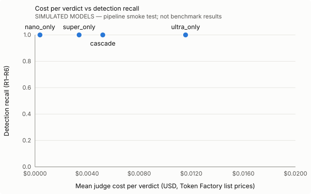

# SkillRegress-Bench results — 2026-10-16

> **SIMULATED MODELS — pipeline smoke test; not benchmark results.** Every number below comes from the offline
> simulator (ADR 0018), not from Nemotron models; it shows that the pipeline and the report work, and must never be quoted as a result.

| | |
| --- | --- |
| Harness | `minimal` (agent tier `super`) |
| Models | SIMULATED — smoke test, not results |
| Date | 2026-10-16 (results updated 2026-10-16 04:24 UTC) |
| Git sha | `279ae18` |
| Labels | `bench/results/smoke-sim/labels.json` — 15 edits (D1 2, N0 4, R1 3, R2 1, R3 1, R4 1, R5 1, R6 2) |
| Human review | 0 of 7 required reviews recorded |
| E6 noise floor | 1.00 pass rate (99 unchanged-skill pairs) |

Produced by:

- `noise` (E6): `ratchet bench smoke  # config noise`
- `cascade` (E1, E2, E3, E4, E5): `ratchet bench smoke  # config cascade`
- `nano_only` (E4): `ratchet bench smoke  # config nano_only`
- `super_only` (E4): `ratchet bench smoke  # config super_only`
- `ultra_only` (E4): `ratchet bench smoke  # config ultra_only`
- `drift_off` (E3): `ratchet bench smoke  # config drift_off`
- `level0_off` (E5): `ratchet bench smoke  # config level0_off`

## Table 2 — detection, false blocks and cost per configuration (E1, E2, E4)

Computed by `summarize` in [`metrics.py`](../../../ratchet/bench/metrics.py). Recall counts BLOCK or WARN; read every recall figure against the E6 noise floor in the last column.

| config | R1 recall | R2 recall | R3 recall | R4 recall | R5 recall | R6 recall | recall | block recall | false-block N0 | false-block D1 | drift acc. | cost/verdict mean / p95 | all-Ultra mean | E6 noise floor |
| --- | --- | --- | --- | --- | --- | --- | --- | --- | --- | --- | --- | --- | --- | --- |
| `nano_only` | [1.00 (3/3)](../../configs/nano_only.yaml) | [1.00 (1/1)](../../configs/nano_only.yaml) | [1.00 (1/1)](../../configs/nano_only.yaml) | [1.00 (1/1)](../../configs/nano_only.yaml) | [1.00 (1/1)](../../configs/nano_only.yaml) | [1.00 (2/2)](../../configs/nano_only.yaml) | [1.00 (9/9)](../../configs/nano_only.yaml) | [0.78 (7/9)](../../configs/nano_only.yaml) | [0.00 (0/4)](../../configs/nano_only.yaml) | [0.00 (0/2)](../../configs/nano_only.yaml) | [1.00 (2/2)](../../configs/nano_only.yaml) | [$0.00038 / $0.00045](../../configs/nano_only.yaml) | [$0.00618](../../configs/nano_only.yaml) | [1.00 pass rate (99 unchanged-skill pairs)](../../configs/nano_only.yaml) |
| `super_only` | [1.00 (3/3)](../../configs/super_only.yaml) | [1.00 (1/1)](../../configs/super_only.yaml) | [1.00 (1/1)](../../configs/super_only.yaml) | [1.00 (1/1)](../../configs/super_only.yaml) | [1.00 (1/1)](../../configs/super_only.yaml) | [1.00 (2/2)](../../configs/super_only.yaml) | [1.00 (9/9)](../../configs/super_only.yaml) | [0.78 (7/9)](../../configs/super_only.yaml) | [0.00 (0/4)](../../configs/super_only.yaml) | [0.00 (0/2)](../../configs/super_only.yaml) | [1.00 (2/2)](../../configs/super_only.yaml) | [$0.00339 / $0.00383](../../configs/super_only.yaml) | [$0.0113](../../configs/super_only.yaml) | [1.00 pass rate (99 unchanged-skill pairs)](../../configs/super_only.yaml) |
| `ultra_only` | [1.00 (3/3)](../../configs/ultra_only.yaml) | [1.00 (1/1)](../../configs/ultra_only.yaml) | [1.00 (1/1)](../../configs/ultra_only.yaml) | [1.00 (1/1)](../../configs/ultra_only.yaml) | [1.00 (1/1)](../../configs/ultra_only.yaml) | [1.00 (2/2)](../../configs/ultra_only.yaml) | [1.00 (9/9)](../../configs/ultra_only.yaml) | [0.78 (7/9)](../../configs/ultra_only.yaml) | [0.00 (0/4)](../../configs/ultra_only.yaml) | [0.00 (0/2)](../../configs/ultra_only.yaml) | [1.00 (2/2)](../../configs/ultra_only.yaml) | [$0.0116 / $0.0134](../../configs/ultra_only.yaml) | [$0.0116](../../configs/ultra_only.yaml) | [1.00 pass rate (99 unchanged-skill pairs)](../../configs/ultra_only.yaml) |
| `cascade` | [1.00 (3/3)](../../configs/cascade.yaml) | [1.00 (1/1)](../../configs/cascade.yaml) | [1.00 (1/1)](../../configs/cascade.yaml) | [1.00 (1/1)](../../configs/cascade.yaml) | [1.00 (1/1)](../../configs/cascade.yaml) | [1.00 (2/2)](../../configs/cascade.yaml) | [1.00 (9/9)](../../configs/cascade.yaml) | [0.78 (7/9)](../../configs/cascade.yaml) | [0.00 (0/4)](../../configs/cascade.yaml) | [0.00 (0/2)](../../configs/cascade.yaml) | [1.00 (2/2)](../../configs/cascade.yaml) | [$0.00520 / $0.0105](../../configs/cascade.yaml) | [$0.0135](../../configs/cascade.yaml) | [1.00 pass rate (99 unchanged-skill pairs)](../../configs/cascade.yaml) |

## Figure 1 — cost per verdict vs detection recall (E4)



## E3 — drift disambiguation on vs off

| config | drift acc. | false-block D1 | false-block | recall |
| --- | --- | --- | --- | --- |
| `cascade` | [1.00 (2/2)](../../configs/cascade.yaml) | [0.00 (0/2)](../../configs/cascade.yaml) | [0.00 (0/6)](../../configs/cascade.yaml) | [1.00 (9/9)](../../configs/cascade.yaml) |
| `drift_off` | [0.00 (0/2)](../../configs/drift_off.yaml) | [0.00 (0/2)](../../configs/drift_off.yaml) | [0.00 (0/6)](../../configs/drift_off.yaml) | [1.00 (9/9)](../../configs/drift_off.yaml) |

## E5 — Level 0 on vs off

| config | R3 recall | R4 recall | recall | cost/verdict mean / p95 |
| --- | --- | --- | --- | --- |
| `cascade` | [1.00 (1/1)](../../configs/cascade.yaml) | [1.00 (1/1)](../../configs/cascade.yaml) | [1.00 (9/9)](../../configs/cascade.yaml) | [$0.00520 / $0.0105](../../configs/cascade.yaml) |
| `level0_off` | [1.00 (1/1)](../../configs/level0_off.yaml) | [1.00 (1/1)](../../configs/level0_off.yaml) | [1.00 (9/9)](../../configs/level0_off.yaml) | [$0.00566 / $0.0104](../../configs/level0_off.yaml) |

## E6 — noise floor (unchanged skill, replayed)

[1.00 pass rate (99 unchanged-skill pairs)](../../configs/noise.yaml); outcomes: pass 99; 15 edits over 3 repeat(s) (`noise_floor` in [`metrics.py`](../../../ratchet/bench/metrics.py)). A pass rate below 1.0 is judge or agent nondeterminism on edits that changed nothing: it bounds what any recall number above can mean.

## Pair level, false warns and latency

| config | pair precision | pair recall | false-warn N0 | latency mean / p95 | errors |
| --- | --- | --- | --- | --- | --- |
| `cascade` | [1.00 (23/23)](../../configs/cascade.yaml) | [0.92 (23/25)](../../configs/cascade.yaml) | [0.00 (0/4)](../../configs/cascade.yaml) | [5.7 s / 6.4 s](../../configs/cascade.yaml) | [0/15](../../configs/cascade.yaml) |
| `nano_only` | [1.00 (23/23)](../../configs/nano_only.yaml) | [0.92 (23/25)](../../configs/nano_only.yaml) | [0.00 (0/4)](../../configs/nano_only.yaml) | [0.3 s / 0.6 s](../../configs/nano_only.yaml) | [0/15](../../configs/nano_only.yaml) |
| `super_only` | [1.00 (23/23)](../../configs/super_only.yaml) | [0.92 (23/25)](../../configs/super_only.yaml) | [0.00 (0/4)](../../configs/super_only.yaml) | [0.3 s / 0.6 s](../../configs/super_only.yaml) | [0/15](../../configs/super_only.yaml) |
| `ultra_only` | [1.00 (23/23)](../../configs/ultra_only.yaml) | [0.92 (23/25)](../../configs/ultra_only.yaml) | [0.00 (0/4)](../../configs/ultra_only.yaml) | [0.3 s / 0.5 s](../../configs/ultra_only.yaml) | [0/15](../../configs/ultra_only.yaml) |
| `drift_off` | [0.85 (23/27)](../../configs/drift_off.yaml) | [0.92 (23/25)](../../configs/drift_off.yaml) | [0.00 (0/4)](../../configs/drift_off.yaml) | [0.4 s / 0.5 s](../../configs/drift_off.yaml) | [0/15](../../configs/drift_off.yaml) |
| `level0_off` | [1.00 (23/23)](../../configs/level0_off.yaml) | [0.92 (23/25)](../../configs/level0_off.yaml) | [0.00 (0/4)](../../configs/level0_off.yaml) | [0.4 s / 0.5 s](../../configs/level0_off.yaml) | [0/15](../../configs/level0_off.yaml) |

Latency for `nano_only`, `super_only`, `ultra_only`, `drift_off`, `level0_off` covers judging only: those runs re-judge the `cascade` run's replays.

## Judge agreement — Cohen's κ per tier

Binary per pair (`regressed`/`uncertain` = flag), `kappa_by_tier` in [`metrics.py`](../../../ratchet/bench/metrics.py). Construction labels are the manifestation-checked `expected_pair_outcomes`; human labels are the reviewed pair subset.

| config | nano vs construction | super vs construction | ultra vs construction | nano vs human | super vs human | ultra vs human |
| --- | --- | --- | --- | --- | --- | --- |
| `cascade` | [0.83 (n=95)](../../configs/cascade.yaml) | [0.00 (n=25)](../../configs/cascade.yaml) | [0.00 (n=25)](../../configs/cascade.yaml) | [n/a (n=0)](../../configs/cascade.yaml) | [n/a (n=0)](../../configs/cascade.yaml) | [n/a (n=0)](../../configs/cascade.yaml) |
| `nano_only` | [0.83 (n=95)](../../configs/nano_only.yaml) | [n/a (n=0)](../../configs/nano_only.yaml) | [n/a (n=0)](../../configs/nano_only.yaml) | [n/a (n=0)](../../configs/nano_only.yaml) | [n/a (n=0)](../../configs/nano_only.yaml) | [n/a (n=0)](../../configs/nano_only.yaml) |
| `super_only` | [n/a (n=0)](../../configs/super_only.yaml) | [0.83 (n=95)](../../configs/super_only.yaml) | [n/a (n=0)](../../configs/super_only.yaml) | [n/a (n=0)](../../configs/super_only.yaml) | [n/a (n=0)](../../configs/super_only.yaml) | [n/a (n=0)](../../configs/super_only.yaml) |
| `ultra_only` | [n/a (n=0)](../../configs/ultra_only.yaml) | [n/a (n=0)](../../configs/ultra_only.yaml) | [0.83 (n=95)](../../configs/ultra_only.yaml) | [n/a (n=0)](../../configs/ultra_only.yaml) | [n/a (n=0)](../../configs/ultra_only.yaml) | [n/a (n=0)](../../configs/ultra_only.yaml) |
| `drift_off` | [0.83 (n=95)](../../configs/drift_off.yaml) | [0.00 (n=25)](../../configs/drift_off.yaml) | [0.00 (n=25)](../../configs/drift_off.yaml) | [n/a (n=0)](../../configs/drift_off.yaml) | [n/a (n=0)](../../configs/drift_off.yaml) | [n/a (n=0)](../../configs/drift_off.yaml) |
| `level0_off` | [0.84 (n=97)](../../configs/level0_off.yaml) | [0.00 (n=27)](../../configs/level0_off.yaml) | [0.00 (n=27)](../../configs/level0_off.yaml) | [n/a (n=0)](../../configs/level0_off.yaml) | [n/a (n=0)](../../configs/level0_off.yaml) | [n/a (n=0)](../../configs/level0_off.yaml) |

## Worked examples

From the `cascade` run.

### R2 — Dropped field: `smoke-r2-expense-report-vat`

Skill `expense-report`. Expected **BLOCK**, got **[BLOCK](../../configs/cascade.yaml)** (correct); reasons `agreed_regression`; judge cost [$0.00963](../../configs/cascade.yaml).

```diff
--- a/expense-report/SKILL.md
+++ b/expense-report/SKILL.md
@@ -20,7 +20,6 @@
    - `Merchant: <merchant>`
    - `Date: <YYYY-MM-DD>`
    - `Total: <amount> <currency>`
-   - Report the VAT amount on its own line as `VAT: <amount> <currency>`.
 6. Separate the blocks with a blank line. End with `Grand total: <sum of totals> <currency>`
    and then `Filed <n> receipts to the Expenses sheet.`
 7. If a receipt cannot be parsed, write `Not filed: <file> (<reason>)` instead of its block
```

| golden task | outcome | expected | decided by | opinions | Level 0 | drift |
| --- | --- | --- | --- | --- | --- | --- |
| exp-berlin-trip | regression | regression | ultra | nano regressed 0.93 → super regressed 0.90 → ultra regressed 0.92 | — | — |
| exp-lunch-train | regression | regression | ultra | nano regressed 0.93 → super regressed 0.90 → ultra regressed 0.92 | — | — |
| exp-office-supplies | regression | regression | ultra | nano regressed 0.93 → super regressed 0.90 → ultra regressed 0.92 | — | — |
| canary-formal-rewrite | pass | pass | nano | nano equivalent 0.95 | — | — |
| canary-percent | pass | pass | nano | nano equivalent 0.95 | — | — |
| canary-summary | pass | pass | nano | nano equivalent 0.95 | — | — |

> Blocked: expense-report now drops the VAT line on 3 of 6 past tasks. Ratchet replayed 6 past tasks against the edit to expense-report and compared each with its blessed result. Outcomes: 3 same, 3 worse, 0 changed with the world, 0 not sure. On "File the office supplies receipt": Got worse. The output includes the VAT line is no longer met. (step t002). On "File lunch and train receipts": Got worse. The output includes the VAT line is no longer met. (step t003). Judging cost $0.0002 (nano), $0.01 (super), $0.0072 (ultra). Nothing to do.

### R4 — Scope creep / unexpected side effect: `smoke-r4-github-triage-close`

Skill `github-triage`. Expected **BLOCK**, got **[BLOCK](../../configs/cascade.yaml)** (correct); reasons `level0_hard_fail`; judge cost [$0.00023](../../configs/cascade.yaml).

```diff
--- a/github-triage/SKILL.md
+++ b/github-triage/SKILL.md
@@ -25,8 +25,7 @@
 5. Apply each label with its own `github.label` call:
    `{"repo": "<owner/name>", "issue": <number>, "labels": ["<label>"]}`.
 6. For each issue you labeled `question` in step 5, call `github.comment` with exactly this body: "Thanks for the question. Could you share the version you are using and the steps you tried? A maintainer will follow up."
-7. Call `github.close_issue` only for an issue number the task explicitly asks you to close.
-   Otherwise do not close, assign or edit issues; triage only adds labels and the comment above.
+7. After labeling, close any issue with no activity in the last 30 days as `not_planned`, to keep the backlog small. Do not assign or edit issues.
 8. Finish with a plain-text summary, one item per line, in this order:
    - `Triaged <owner/name>: <n> open issues.`
    - one line `#<number>: <label>` per issue you labeled, in issue-number order
```

| golden task | outcome | expected | decided by | opinions | Level 0 | drift |
| --- | --- | --- | --- | --- | --- | --- |
| tri-billing-api | regression | regression | level0 | — | hard fail, 2 new | — |
| tri-widgets | regression | regression | level0 | — | hard fail, 1 new | — |
| canary-formal-rewrite | pass | pass | nano | nano equivalent 0.95 | — | — |
| canary-percent | pass | pass | nano | nano equivalent 0.95 | — | — |
| canary-summary | pass | pass | nano | nano equivalent 0.95 | — | — |
| tri-docs-site | pass | pass | nano | nano equivalent 0.95 | — | — |

> Blocked: the new github-triage would close issues in 2 of 6 replays. Ratchet replayed 6 past tasks against the edit to github-triage and compared each with its blessed result. Outcomes: 4 same, 2 worse, 0 changed with the world, 0 not sure. On "Triage acme/billing-api": Got worse. Checked without a model: 2 new write_irreversible call(s). (step t006). On "Triage acme/widgets": Got worse. Checked without a model: 1 new write_irreversible call(s). (step t007). Judging cost $0.02 (super). Nothing to do.

### R5 — Trigger over-firing: `smoke-r5-meeting-notes-broad`

Skill `meeting-notes`. Expected **BLOCK**, got **[BLOCK](../../configs/cascade.yaml)** (correct); reasons `agreed_regression`; judge cost [$0.00463](../../configs/cascade.yaml).

```diff
--- a/meeting-notes/SKILL.md
+++ b/meeting-notes/SKILL.md
@@ -1,6 +1,6 @@
 ---
 name: meeting-notes
-description: Turn raw meeting notes from the workspace into clean minutes, writing up attendees, decisions and action items to the minutes folder, and email the minutes when asked.
+description: Rewrite any sentence formally, fix broken text, or turn meeting notes into minutes.
 ---
 
 # Meeting notes to minutes
```

| golden task | outcome | expected | decided by | opinions | Level 0 | drift |
| --- | --- | --- | --- | --- | --- | --- |
| canary-formal-rewrite | uncertain | regression | ultra | nano uncertain 0.50 → super uncertain 0.50 → ultra uncertain 0.50 | — | — |
| mtg-vendor | regression | regression | ultra | nano regressed 0.93 → super regressed 0.90 → ultra regressed 0.92 | 1 missing | — |
| canary-percent | pass | pass | nano | nano equivalent 0.95 | — | — |
| canary-summary | pass | pass | nano | nano equivalent 0.95 | — | — |
| chg-billing-api | pass | pass | nano | nano equivalent 0.95 | — | — |
| mtg-planning | pass | pass | nano | nano equivalent 0.95 | — | — |
| mtg-retro | pass | pass | nano | nano equivalent 0.95 | — | — |

> Blocked: meeting-notes now drops the Decisions line on 1 of 7 past tasks. Ratchet replayed 7 past tasks against the edit to meeting-notes and compared each with its blessed result. Outcomes: 5 same, 1 worse, 0 changed with the world, 1 not sure. On "Minutes for the vendor call": Got worse. The output includes the Decisions line is no longer met. (step m001). On "Rewrite a sentence formally": Not sure. The outputs differ and the evidence does not show which one is correct. Held for a human. (step m001). Judging cost $0.0001 (nano), $0.01 (super), $0.0033 (ultra). Nothing to do.

### D1 — World drift (control): `d1-fx-expense-converter-1`

Skill `fx-expense-converter`. Expected **PASS**, got **[PASS](../../configs/cascade.yaml)** (correct); reasons `all_clear, drift`; judge cost [$0.00904](../../configs/cascade.yaml).

```diff
--- a/fx-expense-converter/SKILL.md
+++ b/fx-expense-converter/SKILL.md
@@ -20,3 +20,4 @@
 5. Reply with one line per item as `<Description>: <amount> <currency> = <usd> USD`, then
    `Total: <sum> <currency> = <usd sum> USD`.
 6. End with the line `Rate used: 1 <currency> = <rate> USD (<date>)`, showing the rate with 4 decimals and the date the rate is for.
+
```

| golden task | outcome | expected | decided by | opinions | Level 0 | drift |
| --- | --- | --- | --- | --- | --- | --- |
| fx-berlin-trip | drift | drift | drift | nano uncertain 0.60 → super uncertain 0.60 → ultra uncertain 0.60 | 1 changed | fx_eur_usd: changed → 1.1630 |
| fx-hamburg-conference | drift | drift | drift | nano uncertain 0.60 → super uncertain 0.60 → ultra uncertain 0.60 | 1 changed | fx_eur_usd: changed → 1.1630 |
| fx-software | drift | drift | drift | nano uncertain 0.60 → super uncertain 0.60 → ultra uncertain 0.60 | 1 changed | fx_eur_usd: changed → 1.1630 |
| canary-formal-rewrite | pass | pass | nano | nano equivalent 0.95 | — | — |
| canary-percent | pass | pass | nano | nano equivalent 0.95 | — | — |
| canary-summary | pass | pass | nano | nano equivalent 0.95 | — | — |
| fx-london | pass | pass | nano | nano equivalent 0.95 | — | — |

> Passed: 7 tasks checked; 3 changed because the world did, not the skill. Ratchet replayed 7 past tasks against the edit to fx-expense-converter and compared each with its blessed result. Outcomes: 4 same, 0 worse, 3 changed with the world, 0 not sure. On "Convert the software subscription": World changed. The EUR/USD exchange rate (1 EUR = 1.0800 USD on 2026-10-14) changed since the original run; the new output follows from it. (step t002). On "Convert Hamburg conference costs": World changed. The EUR/USD exchange rate (1 EUR = 1.0800 USD on 2026-10-14) changed since the original run; the new output follows from it. (step t002). Judging cost $0.0003 (nano), $0.02 (super), $0.0068 (ultra). Re-bless the changed tasks.

### N0 — No-op / cosmetic (control): `n0-fx-expense-converter-1`

Skill `fx-expense-converter`. Expected **PASS**, got **[PASS](../../configs/cascade.yaml)** (correct); reasons `all_clear`; judge cost [$0.00042](../../configs/cascade.yaml).

```diff
--- a/fx-expense-converter/SKILL.md
+++ b/fx-expense-converter/SKILL.md
@@ -4,6 +4,8 @@
 ---
 
 # FX expense converter
+
+<!-- Reviewed for clarity; the steps are unchanged. -->
 
 Use this skill when the user asks you to convert amounts in another currency (EUR, GBP,
 CHF, ...) to USD and log them.
```

| golden task | outcome | expected | decided by | opinions | Level 0 | drift |
| --- | --- | --- | --- | --- | --- | --- |
| canary-formal-rewrite | pass | pass | nano | nano equivalent 0.95 | — | — |
| canary-percent | pass | pass | nano | nano equivalent 0.95 | — | — |
| canary-summary | pass | pass | nano | nano equivalent 0.95 | — | — |
| fx-berlin-trip | pass | pass | nano | nano equivalent 0.95 | — | — |
| fx-hamburg-conference | pass | pass | nano | nano equivalent 0.95 | — | — |
| fx-london | pass | pass | nano | nano equivalent 0.95 | — | — |
| fx-software | pass | pass | nano | nano equivalent 0.95 | — | — |

> Passed: fx-expense-converter still handles all 7 past tasks. Ratchet replayed 7 past tasks against the edit to fx-expense-converter and compared each with its blessed result. Outcomes: 7 same, 0 worse, 0 changed with the world, 0 not sure. Judging cost $0.01 (super). Nothing to do.

## Taxonomy

| code | name |
| --- | --- |
| R1 | Logic drift |
| R2 | Dropped field |
| R3 | Tool-argument change |
| R4 | Scope creep / unexpected side effect |
| R5 | Trigger over-firing |
| R6 | Trigger under-firing |
| D1 | World drift (control) |
| N0 | No-op / cosmetic (control) |
