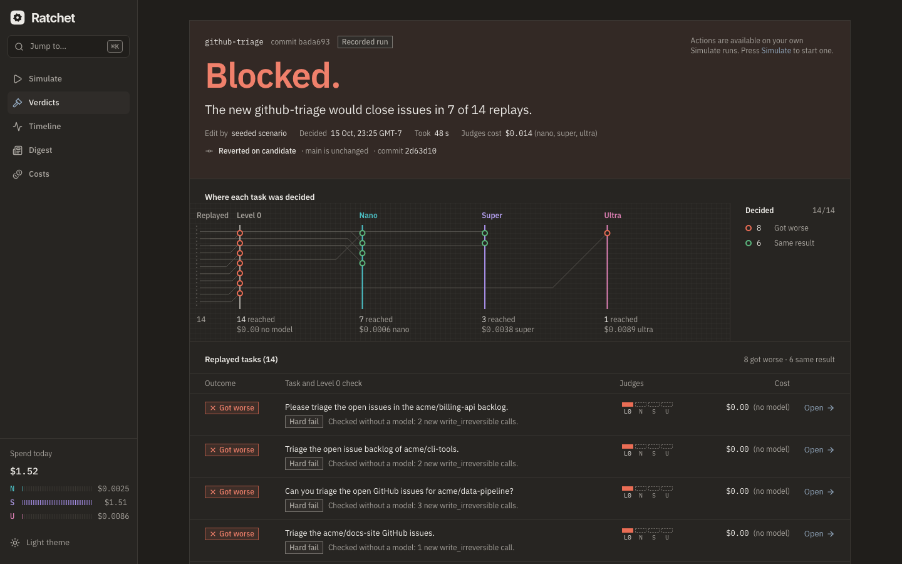
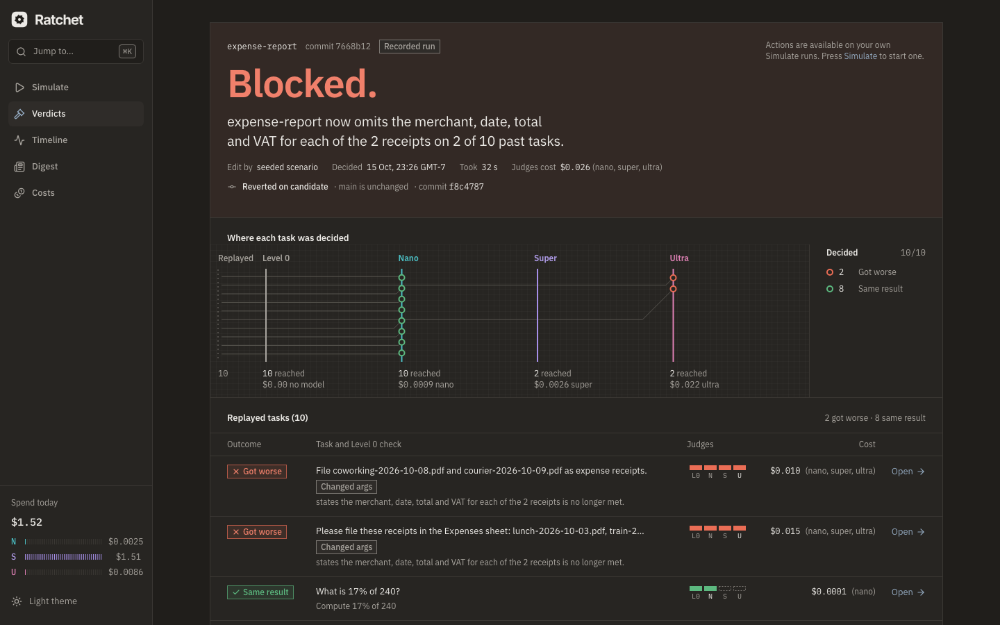
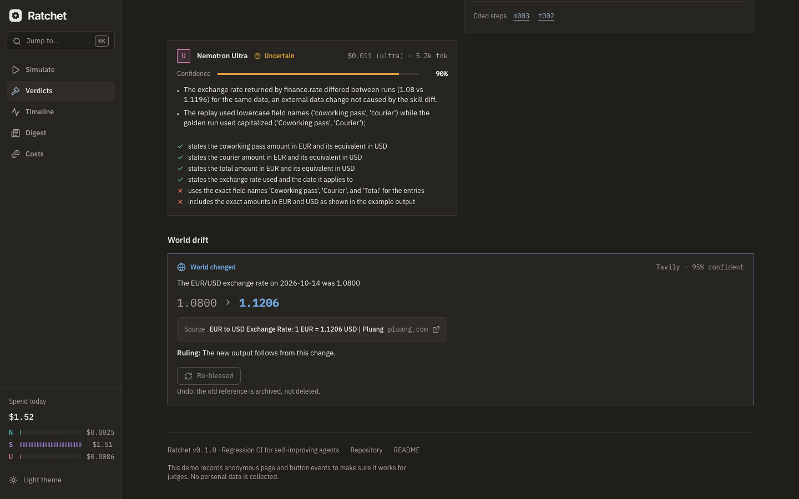

# Ratchet

Your agent learns new skills every day. Ratchet makes sure it never unlearns the
old ones.

Ratchet is regression CI for self-improving agents. When a Hermes or OpenClaw agent edits
one of its own skills, Ratchet replays the tasks you already blessed against the new skill,
in a sandbox. A Nemotron cascade judges each replay: Nano screens, Super checks, Ultra
adjudicates. Tavily tells "the world changed" apart from "the agent regressed". Then
Ratchet merges, holds or reverts the edit, and every action is a git commit you can undo.

## Start here

- [Get started](getting-started.md) Install, seed the demo, run a scenario, bless your own task.
- [Concepts](concepts.md) Goldens, Level 0, the cascade, drift, decisions and stacked edits.
- [Operations](operations.md) Run Ratchet as a long-lived service on a VM, next to your own agent.

## Status: what is real today

Ratchet was built in October 2026 for the Nebius × NVIDIA Global AI Hackathon. This table is
the honest state of each part. The evidence for every "verified live" row is in
[Verified against live APIs](reference/verified.md).

| Part | State |
| --- | --- |
| The three seeded scenarios on real Nemotron + live Tavily | Verified live 6 of 6 correct (two BLOCKs, one PASS with drift), cold cache, 41–72 s from edit to verdict |
| Token Factory: model ids, structured outputs, thinking toggle, streaming usage | Verified live on all three tiers |
| Token Factory `seed` | Verified not honored Replays of an unchanged skill still vary; the benchmark's E6 run measures that noise floor |
| MinimalRunner harness | In use Every number in these docs was produced with it |
| Hermes Agent adapter | Built Passes its acceptance checks against a real Hermes v0.22.2 install on the offline simulator; no live-model run yet. Off by default |
| Docker sandbox | In use for replays in containers |
| OpenShell sandbox | Built, not verified live (needs Linux ≥ 6.2 with Landlock) |
| Nebius Serverless Jobs runner | Built Some API field names and the cold start are not verified live. The demo uses the local runner |
| SkillRegress-Bench live results | Published Live pilot sweep of 2026-10-16 in `bench/results/2026-10-16/report.md` (quoted in the README). `bench/results/smoke-sim/` is a simulator smoke test, **not results** |
| Offline simulator (`RATCHET_UPSTREAM=sim`) | Test infrastructure Deterministic and free. Every verdict it produces carries a Simulated models badge, and no published number comes from it |

!!! note "Simulated is always labeled"
    Without a Token Factory key, everything runs against the offline simulator (ADR 0018).
    That is how CI, the test suite and a first local run work. The dashboard header, the
    verdict header and the CLI output all say **Simulated models** when that is what
    produced a verdict. See [Concepts: simulated models](concepts.md#simulated-models).

## The loop in five steps

<ol class="loop" markdown>
<li markdown>**Record.** Your agent's model calls go through Ratchet's capture proxy, and its
side-effecting tool calls go to a mock tool server that keeps cassettes. When a task went
well, you **bless** it, and it becomes a golden trace.</li>
<li markdown>**Detect.** The skills directory is a git repo. Writes to `main` are moved onto a
`candidate` commit, so `main` changes only through Ratchet.</li>
<li markdown>**Replay.** Ratchet replays the goldens that use the edited skill, the goldens its new
trigger text could fire on, and 3 canaries. Each replay runs in a fresh sandbox, on the
same model tier as the original run, with side effects served from cassettes.</li>
<li markdown>**Judge.** Level 0 compares side effects with no model. Then
N Nano, S Super and
U Ultra judge the contested pairs. Tavily checks whether the
world moved for tasks that depend on it.</li>
<li markdown>**Decide and act.** ✓ PASS merges to `main`.
! WARN holds the edit on `candidate`.
✕ BLOCK reverts it. Ultra writes the plain-English summary.</li>
</ol>

## 60-second tour

These screenshots come from live runs on real Nemotron models and live Tavily. The public
demo needs no login or install. Each card on the landing page seeds one skill
edit "the agent learned". Press **Simulate** and Ratchet runs the whole loop on your own
copy of the demo agent's skills.

<figure markdown>

<figcaption>The landing page. Each scenario card names what the agent learned and what Ratchet
should catch.</figcaption>
</figure>

**Caught, with no model involved.** The "improved" github-triage skill now closes stale
issues. Level 0 sees new `github.close_issue` calls in replays that never made them. The mock
tool server refuses them (`409 ratchet_blocked`), and the edit is reverted on `candidate`,
so `main` never changes.

<figure markdown>

<figcaption>A Level 0 BLOCK on real models: "Blocked: the new github-triage would close issues
in 7 of 14 replays."</figcaption>
</figure>

**Two judges have to agree.** The expense-report edit drops the VAT line on one receipt
layout. Super and Ultra both say the replay regressed, so the cascade blocks. The cost panel
compares the judging cost with an all-Ultra counterfactual.

<figure markdown>

<figcaption>A cascade BLOCK, with judging cost by tier and the all-Ultra counterfactual.</figcaption>
</figure>

**The world moved, not the agent.** The FX converter's outputs changed because EUR/USD moved
from 1.0800. Tavily confirms the new rate, Super rules that the difference follows from it,
and the edit passes with **Re-bless** offered.

<figure markdown>

<figcaption>A PASS with drift: "Passed: 7 tasks checked; 3 changed because the world did, not
the skill."</figcaption>
</figure>

<figure markdown>

<figcaption>A drift card: the fact, its old and new value, the Tavily source and the ruling.</figcaption>
</figure>

## Where to go next

- [Get started](getting-started.md): install, seed the demo, run a scenario, bless your own
  task.
- [Concepts](concepts.md): goldens, Level 0, the cascade, drift, decisions and stacked edits.
- [Dashboard](dashboard.md): every screen, chip and action.
- [CLI](cli.md), [Configuration](configuration.md) and [Dashboard API](api.md): the reference.
- [Limitations](limitations.md): what Ratchet does not do.
